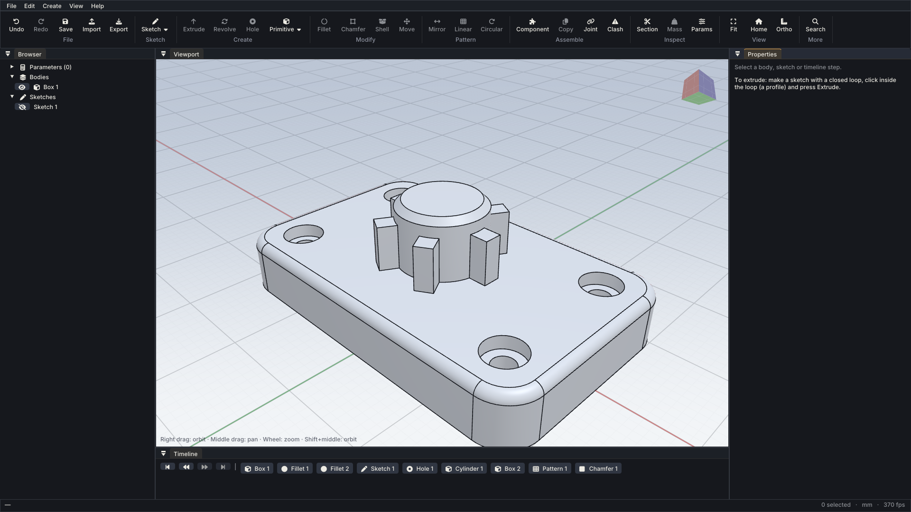
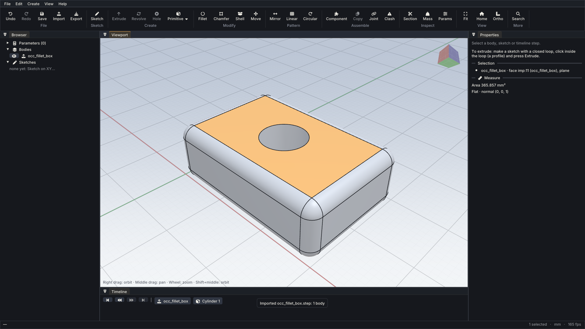
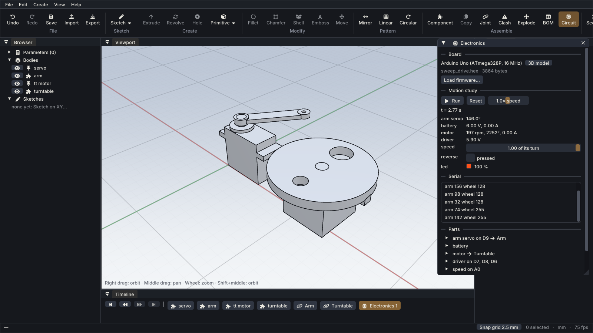
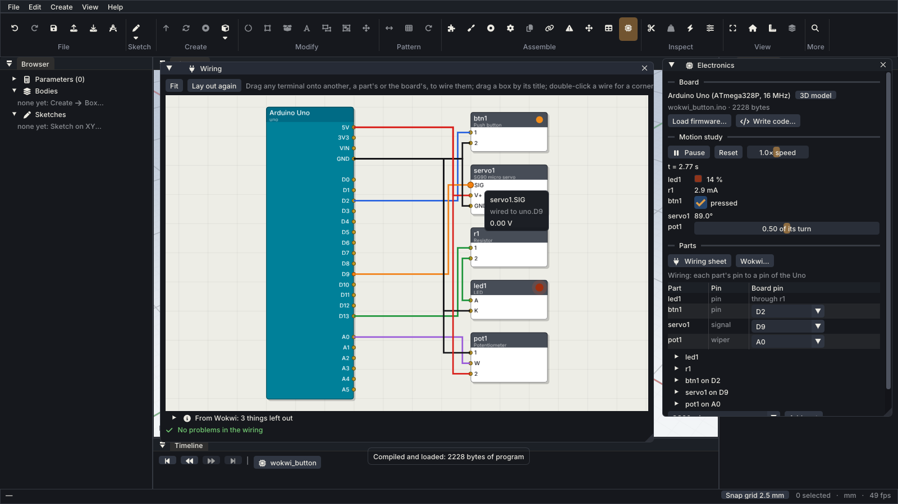
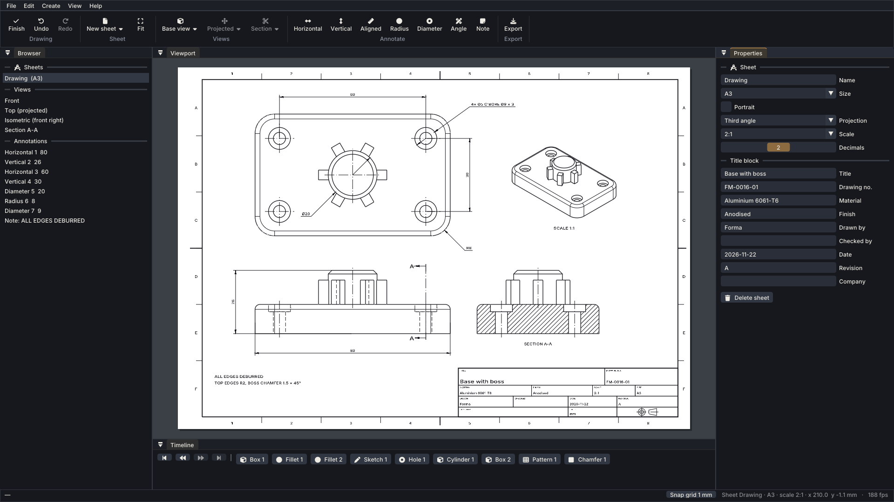

<h1 align="center"></h1>

A parametric 3D CAD program written in Go, with its own geometry kernel.

You draw constrained sketches, turn them into solids with extrudes, revolves,
holes, fillets and booleans, and edit any step of the history afterwards.
It is built along the lines of Fusion 360 and Onshape.
The kernel is a pure-Go B-rep on exact analytic surfaces: planes, cylinders,
cones, spheres and tori. It doesn't use OpenCASCADE or any other CAD library.
The interface is a docked Dear ImGui layout drawn with OpenGL 4.1.



<table>
<tr>
<td width="50%"></td>
<td width="50%"></td>
</tr>
<tr>
<td><b>Sketcher.</b> Constraints and dimensions are solved as you draw.
The sketch turns green once it is fully constrained, and dimensions accept
expressions such as <code>30 + 30</code>.</td>
<td><b>Section view.</b> The same part shelled to 1.5 mm and cut on a plane,
with the cut faces hatched.</td>
</tr>
<tr>
<td></td>
<td></td>
</tr>
<tr>
<td><b>Inspect.</b> Validity checks, mass properties (volume, mass, centroid,
inertia) and measurement.</td>
<td><b>STEP in and out.</b> A part written by OpenCASCADE, imported and
drilled like any other body.</td>
</tr>
<tr>
<td></td>
<td></td>
</tr>
<tr>
<td><b>Assemblies.</b> Components from other files, joints between them, and
interference checks.</td>
<td><b>Electronics.</b> An Arduino sketch runs on an emulated Uno, and its
servo and motor move the assembly's joints.</td>
</tr>
<tr>
<td colspan="2"></td>
</tr>
<tr>
<td colspan="2"><b>Wiring.</b> Wires drawn pin to pin and part to part on a wiring sheet,
checked as they are drawn and followed by the simulation. A Wokwi project
opens with its wiring and sketch.</td>
</tr>
<tr>
<td colspan="2"></td>
</tr>
<tr>
<td colspan="2"><b>Drawings.</b> Views of the part with hidden lines and centre
lines, a section, dimensions tied to its edges and a title block, exported
as PDF, SVG or DXF.</td>
</tr>
</table>

## Features

- **Sketcher.** Points, lines, rectangles, circles, arcs, Bézier splines and
  construction geometry.
  - Constraints: coincident, horizontal, vertical, parallel, perpendicular,
    tangent, equal, concentric, midpoint and fix.
  - Dimensions: distance, angle, radius and diameter, each of which can be an
    expression (`20mm + w/2`, `1in`, `45deg`).
  - A Levenberg–Marquardt solver counts the degrees of freedom and refuses
    constraints that are redundant or conflicting.
  - Profiles, holes included, are found automatically.
  - An offset tool copies a chain of curves to one side, mitring its
    corners, and the copy follows the curves and its distance.
  - A sketch goes on a standard plane or on a face: a flat one, or a
    curved one (cylinder, cone, sphere, torus) touching it where it was
    clicked, upright along its axis. It can be moved afterwards: offset
    along its normal, turned, moved in its plane, or put on another face.
- **Features and history.** Extrude and revolve, primitives, holes (simple,
  counterbored, countersunk), fillet (following tangent edges; edge sets
  with radii of their own; ball-shaped corners where three rounds meet) and
  chamfer (equal, two distances, or a distance and an angle), shell, emboss
  (text raised, engraved or inlaid, and wrapped round a cylinder or cone),
  mirror, linear and circular patterns, and moving bodies with a gizmo.
  - Every feature can make a new body, or join, cut or intersect with the
    bodies it touches.
  - Combine joins, cuts or intersects bodies already made: the first body
    picked is the target, the others the tools, kept or used up.
  - Split cuts a body in two along a plane (XY, XZ, YZ, moved along its
    normal, or a flat face of another body), keeping both halves or one:
    a part too big for the printer, or a two-colour print in halves.
  - A parameters table drives the dimensions.
  - The timeline has a rollback marker, regeneration is incremental, and undo
    and redo work for every step.
- **Persistent naming.** Faces are named by the feature that made them, so a
  sketch on a face or a fillet on an edge still finds its target after an
  edit upstream.
- **Booleans** on the analytic surfaces:
  - intersection curves are traced, then made exact where the surfaces meet
    in a line, circle or ellipse;
  - each face is split in its own parameter space and classified by winding
    number;
  - faces on the same plane are merged afterwards.
  
  Fuzz tests check the results against volume identities.
- **Assemblies.** Components from other `.forma` files; rigid, revolute,
  slider and cylindrical joints with motion and limits; grounding;
  interference checks; a bill of materials (CSV) and an exploded view.
- **Screws, washers and nuts.** ISO metric screws as components: socket
  head cap (ISO 4762), button head (ISO 7380), countersunk (ISO 10642) and
  hex head (ISO 4017), M2 to M12 at their standard lengths, built from the
  standards' tables; their size and length are changed in Properties. With
  a hole's rim selected, a screw goes into each, jointed there so it
  follows the hole when the part or the hole changes, and turns in it.
  Plain and large washers (ISO 7089, ISO 7093-1) and hex nuts (ISO 4032,
  thin ISO 4035) go on a hole's rim the same way, each onto what is
  already there: a washer under a screw's head, a washer and a nut where
  it comes out. Holes can be made for a screw: clearance (close, normal or
  loose, ISO 273) or tapped, counterbored or countersunk to take the
  screw's head.
  Threads are drawn on drawings, or modelled as a solid for 3D printing
  (Thread: Modelled on a screw, nut or tapped hole).
- **Inspect.** Measuring, mass properties and section views.
- **Stress analysis.** A part meshed with 10-node tetrahedra, faces held
  fixed or loaded by a force or a pressure, a material from a list, and
  the von Mises stress or displacement painted on the deformed part with
  the maximum stress and the safety factor (checked against beam theory
  and a plate with a hole).
- **Electronics.** An Arduino Uno emulated in Go (the ATmega328P with its
  timers, serial port and ADC) runs a real compiled sketch (a `.hex`, or an
  `.ino` built with arduino-cli). Servos, gear motors, motor drivers,
  batteries, pots, buttons and LEDs from a small library are wired to its
  pins, and their shafts drive the assembly's joints in a motion study:
  run it, turn a pot, press a button (or hold the mouse on its 3D model),
  watch the LEDs light, read the serial monitor. The parts
  also come as 3D models (Uno, SG90, TT motor, AA holder, driver boards,
  push button, pot, LED) to design round, put in the design as each part
  is added.
  - Wires are drawn on a wiring sheet, pin to pin and part to part (a
    battery through a switch to an LED, an LED through its resistor): the
    Uno and each part a box with its terminals, wires routed square and
    coloured by what they carry (or as you pick), boxes and corners moved
    by dragging. The simulation follows the wires, solving the circuit's
    nets each step (LED currents through their resistors, a pot's divider
    read by the ADC, a servo with no supply standing still), and the sheet
    checks the wiring as it is drawn: shorts, an LED with no resistor, a
    motor or a servo's supply on a pin, terminals left unwired. Each
    part's Wires list in the Electronics window wires its terminals to
    other parts or the board without the sheet.
  - A Wokwi project (its `diagram.json` and sketch) opens as a circuit,
    wired as it was, breadboard rails and colours included, its sketch
    compiled; parts Forma doesn't have are listed. Circuits from before
    the wires open with the wires they meant.
  - The sketch's code is written in Forma (an editor with C++
    highlighting, examples to start from, compile errors marked on their
    lines) or in VS Code, and compiled with arduino-cli into the firmware.
    Without arduino-cli, Forma downloads it from Arduino and sets up the
    Uno's core and the Servo library.
- **Drawings.** Sheets from A4 to A0 (or ANSI A–E) with a title block, in
  third or first angle projection.
  - Front, top, side and isometric views, laid out and scaled to the sheet.
  - Hidden lines, silhouettes of curved faces, and centre lines on holes
    and bosses.
  - Projected views and sections (cut by the kernel and hatched) that stay
    lined up with the view they come from.
  - Horizontal, vertical, aligned, radius, diameter and angle dimensions,
    tied to the edges they measure, so they follow an edit. Notes.
  - Hole callouts (size, depth, thread, counterbore or countersink, with
    the symbols), one at a time or on every hole of a view, and threads
    drawn as thin lines on tapped holes and screws.
  - Exported as PDF, SVG or DXF R12. The sheets are saved in the design.
- **Exchange.**
  - STEP AP214: export of solids and assemblies, and import of
    AP203/AP214/AP242 solids on analytic surfaces.
  - STL in (as a reference mesh) and out; OBJ out; 3MF in: each part a
    solid of flat faces with its name and colour, to cut, split and
    combine like any body.
  - 3MF out for slicers: each visible body a part with its colour, the
    parts kept together as one object, millimetres, watertight meshes.
    Any body can be given a colour in Properties, shown in the view too.
  - Separate a 3MF (or STL) into part files (File menu): each part the
    file puts on the plate written as an STL of its own, named as the file
    names it, turned as it was laid out for printing and stood on the bed;
    optionally broken into its loose pieces. A slicer project of a detailed
    figure (34 parts, 12 million triangles, 1 GB of XML) takes about ten
    seconds. The design is left alone.
  - STEP output is checked against OpenCASCADE in the tests.
- **App.** A ribbon toolbar that fits any window (names, then icons only,
  then scrolling as it narrows), a Ctrl+K command palette, native file dialogs,
  autosave, a question before closing with unsaved changes, and exact
  picking from an ID buffer. Any body can be shown
  in X-ray: see-through, its edges dashed on top, and picked through.
- **Dragging.** Arrows to resize features, a Resize · Move · Turn · Scale
  bar, and snapping to a set increment with Ctrl for free movement and
  Shift for fine control.

What doesn't work yet is listed, with IDs, in
[docs/LIMITATIONS.md](docs/LIMITATIONS.md). What each milestone added is in
[docs/MILESTONES.md](docs/MILESTONES.md).

## Downloads

Each [release](https://github.com/pietromezzadri/Forma/releases) has builds
for Windows (64-bit), macOS (11 or later, one app for Apple silicon and
Intel) and Linux (x86-64, X11 or XWayland). The macOS app isn't notarised:
the first time, right-click it and choose Open. On Linux the file dialogs
need zenity (or kdialog) installed.

## Building

You need Go 1.26 or newer, a C compiler for cgo (on Windows the MSYS2 MinGW
gcc works, on macOS Xcode's command line tools), and OpenGL 4.1. On Linux,
the X11 and OpenGL headers too (Debian and Ubuntu: `libx11-dev libxcursor-dev
libxrandr-dev libxinerama-dev libxi-dev libxxf86vm-dev libgl1-mesa-dev`), and
build with `-tags x11` (GLFW builds Wayland support as well unless told
not to, which wants the Wayland headers).

```bash
go run .            # the app
go test ./...       # kernel, sketcher, booleans, STEP, design history: no window needed
go vet ./...
```

On Windows, run it from PowerShell or cmd. Git Bash can put the wrong DLLs on
the path. Forma is developed on Windows; the release builds for macOS and
Linux are made and tested by the release workflow
(`tools/release/build.sh`), but have had little use yet.

### Optional checks

- `FORMA_FREECAD` set to FreeCAD's `bin/python.exe` makes the `io` tests read
  Forma's STEP files with OpenCASCADE and compare validity and volumes
  (`tools/stepcheck`).
- `go run ./tools/stlcheck part.stl` reports an STL's facets and volume, and
  whether it is closed and consistently oriented.
- `avr/testdata/build.ps1` recompiles the Arduino sketches the emulator's
  tests run, with arduino-cli and its `arduino:avr` core (the compiled
  `.hex` files are kept, so the tests don't need it).

## Using it

| Input | Action |
|---|---|
| Right drag (or Shift + middle drag) | Orbit about the point under the cursor |
| Middle drag | Pan |
| Wheel | Zoom toward the cursor |
| Click a body | Select that face and the body (its Move · Turn · Scale gizmo comes up) |
| Ctrl+click (view, browser, timeline) | Add to the selection: several steps are edited together, several bodies rounded at once |
| Drag on empty space | Box-select the edges it shows (Shift: faces) |
| Double-click a body / an edge | Select the whole body / the edge's tangent chain |
| Hold the mouse on a button's model (study running) | Press the button |
| F | Fit the view |
| Numpad | Standard views |
| Ctrl+K | Command palette |
| Shift+E / Shift+R | Extrude / revolve the selected profile |
| Ctrl+Z / Ctrl+Y | Undo / redo |
| Ctrl+S / Ctrl+O | Save / open a `.forma` design |
| Ctrl+I / Ctrl+E | Import (STEP, STL) / export (STEP, STL, OBJ, 3MF) |
| G | Grid snap on / off (Ctrl held while dragging: free; Shift: fine) |
| B (in a sketch) | Spline tool |
| Drawing (File group) | The design's drawing sheet: wheel zooms, middle drag pans, drag a view, dimension or note to move it, Finish goes back |
| F1 | Shortcuts |

A typical part:

1. Pick a plane in Sketch.
2. Draw a profile and dimension it.
3. Click Finish.
4. Select the region and press Extrude.
5. Add holes, fillets and patterns from the ribbon.

Every input in Properties takes an expression, and any step in the timeline
can be edited, suppressed or rolled back to.

## Screenshots from scripts

`FORMA_CAPTURE=captures/readme.json` opens a hidden window that never takes
focus. It plays a script of commands, mouse moves and key presses, and writes
PNGs to `captures/out/`. The images above come from that script. See
`app/capture.go` for the actions.

## Layout

| Package | What's in it |
|---|---|
| `geom/` | float64 vectors, frames, curves (line, circle, ellipse, polyline), surfaces, transforms |
| `brep/` | half-edge B-rep, builder and Euler operators, validity check, tessellation, booleans, face merging, mass properties |
| `ops/` | primitives, extrude, revolve, fillet and chamfer, holes, shell |
| `fea/` | static stress analysis: volume mesher, 10-node tetrahedra, solver |
| `drawing/` | drawings: views with hidden lines, sections, sheets, dimensions, SVG / PDF / DXF |
| `avr/` | an ATmega328P emulator (an Arduino Uno's chip): CPU, ports, timers, serial, ADC |
| `elec/` | an Arduino sketch run against batteries, motor drivers, motors, servos, LEDs, buttons; the wiring's nets solved as a DC circuit; the parts library |
| `sketch/` | sketch entities, constraints, solver, region detection |
| `expr/` | expressions with units |
| `doc/` | the design: parameters, feature history, regeneration, references, assemblies, `.forma` files |
| `io/` | STEP reader and writer, STL, OBJ, 3MF |
| `render/` | shaders, viewport target, grid, ID-buffer picking |
| `app/`, `ui/` | commands, tools, panels, ribbon, capture scripts |

## Roadmap

- **M9 splines** (mostly done): Bézier curves in sketches, extruded and
  revolved into exact faces, in booleans and STEP; dragging with snapping,
  increments and fine control; Resize · Move · Turn · Scale; a transform
  box for sketch selections. Left: fillets and shells on spline faces.
- **M10 text and projection** (done): text in sketches from system fonts,
  with the text itself a design parameter so everything built on it follows
  an edit; body edges projected into a sketch and kept linked.
- **M11 emboss and inlay** (done): texts projected onto curved faces,
  raised, engraved or inlaid (the pocket with a clearance, the letters as
  bodies of their own: a name inlaid into a bowl, printed in two colours).
  Since: text wrapped round cylinders and cones. Left: letters over
  several faces.
- **M12 ribbed forms** (done): a sketch offset tool, fins patterned round
  a revolved body (a pattern's copies that stand apart go in as one
  boolean), clearance on any inlay, and booleans 2–3× faster. Left: more
  speed ([K3](docs/LIMITATIONS.md)).
- **M13 assembly** (done): a bill of materials, exploded views,
  grounding, joint limits. Left: rigid groups, contact, motion studies.
- **M14 simulation** (done): static stress analysis — a part filled with
  quadratic tetrahedra, faces held fixed and loaded (force or pressure),
  materials, von Mises stress and displacement plotted on the deformed
  part, the safety factor. Left: a faster solver, contact, assemblies,
  thermal and modal studies.
- **M15 electronics and behaviour** (done, see
  [docs/ELECTRONICS.md](docs/ELECTRONICS.md)): the real Arduino firmware run
  on an emulated ATmega328P, wired to battery, driver, motor and servo
  models that drive the assembly's joints over time (a code-driven motion
  study), and the parts as 3D components. Left: a car that drives on the
  floor (dynamics, wheel contact), loads from the mechanism back on the
  motors, SPI / I2C parts (Wokwi diagrams are read since M21).
  Circuit-level SPICE simulation is left to KiCad / LTspice.
- **M16 drawings** (done): sheets with orthographic and isometric views,
  hidden lines, sections, centre lines, dimensions that follow the model,
  and a title block, exported as PDF, SVG or DXF. Left: detail and broken
  views, a parts list with balloons, tolerances and GD&T
  ([DW1–DW12](docs/LIMITATIONS.md)).
- **Printing** (0.3.0, mostly done): Split Body and 3MF export with a colour
  per part, separating a 3MF or STL into part files, 3MF import as solids
  (done). Left: curved faces fitted to imported meshes,
  slicer settings in the file, splitting
  along a sketch or a curved face ([X1, E8](docs/LIMITATIONS.md)).
- **M17 car dynamics** (planned): rigid-body dynamics and wheel contact, so
  a car run by its Arduino sketch drives on the floor, and loads from the
  mechanism back on its motors ([EL6](docs/LIMITATIONS.md)).
- **M18 scripted parts** (planned): parts written in Starlark, with
  parameters, as a step in the timeline like any feature.
- **M19 fillet upgrades** (0.4.0, mostly done): ball corners where three
  rounds meet at a corner of flat faces, chamfers by two distances or a distance
  and an angle, edge sets with radii of their own, rounds that follow
  tangent edges (done: every edge of a box rounds into the rounded box of
  the textbook; with the uprights larger, the rims carry round their
  corners). Left: blended corners where smaller rounds meet larger ones
  (mitred now), corners of curved faces or of more than three edges, more
  kinds of edges ([F1–F5](docs/LIMITATIONS.md)).
- **M20 screws and threaded holes** (done): ISO metric screws (socket
  head, button head, countersunk, hex) as components, M2 to M12, and holes
  made for them — clearance or tapped, counterbored or countersunk for the
  head — with a screw jointed into each selected hole (done, in 0.4.0);
  threads on drawings and hole callouts, washers and nuts, modelled
  threads (done). Left: finer pitches, inch sizes, lock nuts, a thread
  runout ([H1, FS1–FS4](docs/LIMITATIONS.md)).
- **M21 circuit wiring** (done, see [docs/WIRING.md](docs/WIRING.md)):
  wires drawn from pin to pin on a wiring sheet, so parts connect to each
  other and not only to the board (a button straight to an LED, a battery
  through a switch), the simulation following the wires as a DC circuit,
  checks for shorts and missing resistors, and a Wokwi `diagram.json`
  read with its wiring and sketch. Left: a breadboard view, capacitors
  and transistors, more Wokwi parts ([EL11](docs/LIMITATIONS.md)).
- **M22 cables** (planned, see [docs/WIRING.md](docs/WIRING.md)): the
  circuit's wires as cables in the assembly, from the pins of the parts'
  3D models along a path you shape, as thick as their gauge and coloured as
  the wire, checked for clashes and tight bends, following the parts as
  they move, with cut lengths in the parts list and a wire list.

## Stack

- Go.
- [go-gl/glfw](https://github.com/go-gl/glfw) 3.4 and
  [go-gl/gl](https://github.com/go-gl/gl) 4.1 core.
- [AllenDang/cimgui-go](https://github.com/AllenDang/cimgui-go) 1.6.1:
  Dear ImGui 1.93 with docking, and ImGuizmo.
- [ncruces/zenity](https://github.com/ncruces/zenity) for the file dialogs.
- Fonts: Inter and Font Awesome Free (SIL OFL; see `assets/fonts/CREDITS.txt`).
