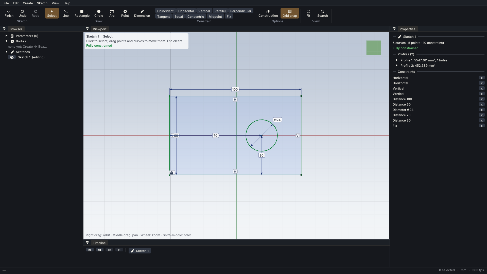
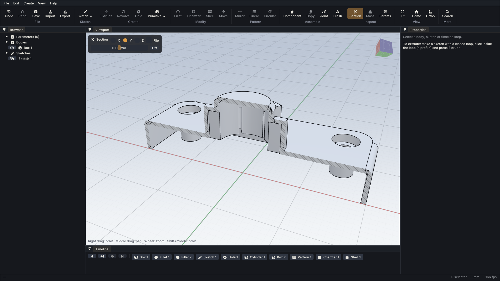
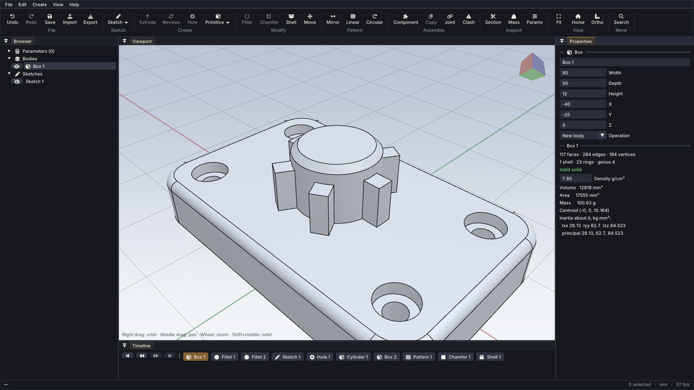
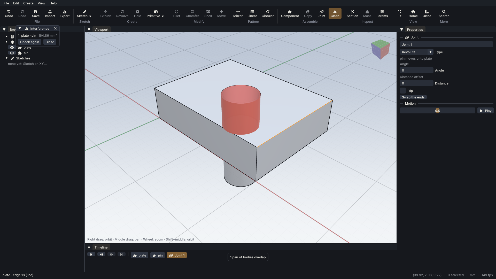

<h1 align="center"></h1>

A parametric 3D CAD program written in Go, with its own geometry kernel.

You draw constrained sketches, turn them into solids with extrudes, revolves,
holes, fillets and booleans, and edit any step of the history afterwards.
It is built along the lines of Fusion 360 and Onshape.
The kernel is a pure-Go B-rep on exact analytic surfaces: planes, cylinders,
cones, spheres and tori. It doesn't use OpenCASCADE or any other CAD library.
The interface is a docked Dear ImGui layout drawn with OpenGL 4.1.


<table>
<tr>
<td width="50%"></td>
<td width="50%"></td>
</tr>
<tr>
<td><b>Sketcher.</b> Constraints and dimensions are solved as you draw.
The sketch turns green once it is fully constrained, and dimensions accept
expressions such as <code>30 + 30</code>.</td>
<td><b>Section view.</b> The same part shelled to 1.5 mm and cut on a plane,
with the cut faces hatched.</td>
</tr>
<tr>
<td></td>
<td></td>
</tr>
<tr>
<td><b>Inspect.</b> Validity checks, mass properties (volume, mass, centroid,
inertia) and measurement.</td>
<td><b>STEP in and out.</b> A part written by OpenCASCADE, imported and
drilled like any other body.</td>
</tr>
<tr>
<td></td>
<td></td>
</tr>
<tr>
<td><b>Assemblies.</b> Components from other files, joints between them, and
interference checks.</td>
<td></td>
</tr>
</table>

## Features

- **Sketcher.** Points, lines, rectangles, circles, arcs, Bézier splines and
  construction geometry.
  - Constraints: coincident, horizontal, vertical, parallel, perpendicular,
    tangent, equal, concentric, midpoint and fix.
  - Dimensions: distance, angle, radius and diameter, each of which can be an
    expression (`20mm + w/2`, `1in`, `45deg`).
  - A Levenberg–Marquardt solver counts the degrees of freedom and refuses
    constraints that are redundant or conflicting.
  - Profiles, holes included, are found automatically.
- **Features and history.** Extrude and revolve, primitives, holes (simple,
  counterbored, countersunk), fillet and chamfer, shell, mirror, linear and
  circular patterns, and moving bodies with a gizmo.
  - Every feature can make a new body, or join, cut or intersect with the
    bodies it touches.
  - A parameters table drives the dimensions.
  - The timeline has a rollback marker, regeneration is incremental, and undo
    and redo work for every step.
- **Persistent naming.** Faces are named by the feature that made them, so a
  sketch on a face or a fillet on an edge still finds its target after an
  edit upstream.
- **Booleans** on the analytic surfaces:
  - intersection curves are traced, then made exact where the surfaces meet
    in a line, circle or ellipse;
  - each face is split in its own parameter space and classified by winding
    number;
  - faces on the same plane are merged afterwards.
  
  Fuzz tests check the results against volume identities.
- **Assemblies.** Components from other `.forma` files; rigid, revolute,
  slider and cylindrical joints with motion; interference checks.
- **Inspect.** Measuring, mass properties and section views.
- **Exchange.**
  - STEP AP214: export of solids and assemblies, and import of
    AP203/AP214/AP242 solids on analytic surfaces.
  - STL in (as a reference mesh) and out; OBJ out.
  - STEP output is checked against OpenCASCADE in the tests.
- **App.** A ribbon toolbar, a Ctrl+K command palette, native file dialogs,
  autosave, and exact picking from an ID buffer.
- **Dragging.** Arrows to resize features, a Resize · Move · Turn · Scale
  bar, and snapping to a set increment with Ctrl for free movement and
  Shift for fine control.

What doesn't work yet is listed, with IDs, in
[docs/LIMITATIONS.md](docs/LIMITATIONS.md). What each milestone added is in
[docs/MILESTONES.md](docs/MILESTONES.md).

## Building

You need Go 1.26 or newer, a C compiler for cgo (on Windows the MSYS2 MinGW
gcc works), and OpenGL 4.1.

```bash
go run .            # the app
go test ./...       # kernel, sketcher, booleans, STEP, design history: no window needed
go vet ./...
```

On Windows, run it from PowerShell or cmd. Git Bash can put the wrong DLLs on
the path. Forma has been developed and tested on Windows only. Native file
dialogs on macOS and Linux go through zenity and haven't been tried.

### Optional checks

- `FORMA_FREECAD` set to FreeCAD's `bin/python.exe` makes the `io` tests read
  Forma's STEP files with OpenCASCADE and compare validity and volumes
  (`tools/stepcheck`).
- `go run ./tools/stlcheck part.stl` reports an STL's facets and volume, and
  whether it is closed and consistently oriented.

## Using it

| Input | Action |
|---|---|
| Right drag (or Shift + middle drag) | Orbit about the point under the cursor |
| Middle drag | Pan |
| Wheel | Zoom toward the cursor |
| F | Fit the view |
| Numpad | Standard views |
| Ctrl+K | Command palette |
| Shift+E / Shift+R | Extrude / revolve the selected profile |
| Ctrl+Z / Ctrl+Y | Undo / redo |
| Ctrl+S / Ctrl+O | Save / open a `.forma` design |
| Ctrl+I / Ctrl+E | Import / export (STEP, STL, OBJ) |
| G | Grid snap on / off (Ctrl held while dragging: free; Shift: fine) |
| B (in a sketch) | Spline tool |
| F1 | Shortcuts |

A typical part:

1. Pick a plane in Sketch.
2. Draw a profile and dimension it.
3. Click Finish.
4. Select the region and press Extrude.
5. Add holes, fillets and patterns from the ribbon.

Every input in Properties takes an expression, and any step in the timeline
can be edited, suppressed or rolled back to.

## Screenshots from scripts

`FORMA_CAPTURE=captures/readme.json` opens a hidden window that never takes
focus. It plays a script of commands, mouse moves and key presses, and writes
PNGs to `captures/out/`. The images above come from that script. See
`app/capture.go` for the actions.

## Layout

| Package | What's in it |
|---|---|
| `geom/` | float64 vectors, frames, curves (line, circle, ellipse, polyline), surfaces, transforms |
| `brep/` | half-edge B-rep, builder and Euler operators, validity check, tessellation, booleans, face merging, mass properties |
| `ops/` | primitives, extrude, revolve, fillet and chamfer, holes, shell |
| `sketch/` | sketch entities, constraints, solver, region detection |
| `expr/` | expressions with units |
| `doc/` | the design: parameters, feature history, regeneration, references, assemblies, `.forma` files |
| `io/` | STEP reader and writer, STL, OBJ |
| `render/` | shaders, viewport target, grid, ID-buffer picking |
| `app/`, `ui/` | commands, tools, panels, ribbon, capture scripts |

## Roadmap

- **M9 splines** (mostly done): Bézier curves in sketches, extruded and
  revolved into exact faces, in booleans and STEP; dragging with snapping,
  increments and fine control; Resize · Move · Turn · Scale. Left: a
  transform box for sketch selections, fillets on spline faces.
- **M10 text and projection:** text in sketches from system fonts, with the
  text itself a design parameter so everything built on it follows an edit;
  body edges projected into a sketch and kept linked.
- **M11 emboss and inlay:** sketches wrapped onto curved faces, raised or
  cut, and an inlay mode giving the pocket with a clearance and the inlay as
  its own body (a name inlaid into a bowl, printed in two colours).
- **M12 ribbed forms:** a sketch offset tool, many fins patterned round a
  revolved body, and much faster booleans ([K3](docs/LIMITATIONS.md)).
- **M13 assembly:** a bill of materials, exploded views, grounding, joint
  limits.
- **M14 simulation:** static stress analysis (volume mesh, loads and supports
  on faces, materials, stress and displacement plots).
- Later: corner patches where three fillets meet
  ([F2](docs/LIMITATIONS.md)), 2D drawings to SVG / PDF, scripted parts in
  Starlark.

## Stack

- Go.
- [go-gl/glfw](https://github.com/go-gl/glfw) 3.4 and
  [go-gl/gl](https://github.com/go-gl/gl) 4.1 core.
- [AllenDang/cimgui-go](https://github.com/AllenDang/cimgui-go) 1.6.1:
  Dear ImGui 1.93 with docking, and ImGuizmo.
- [ncruces/zenity](https://github.com/ncruces/zenity) for the file dialogs.
- Fonts: Inter and Font Awesome Free (SIL OFL; see `assets/fonts/CREDITS.txt`).
